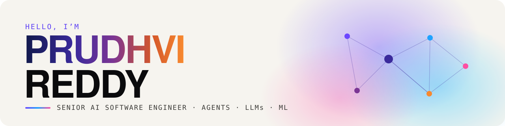

  

  
  
  

  

## 👋 About me

Senior AI Software Engineer in Los Angeles with **6 years** in machine learning and LLM applications. I build agents that plan multistep work, call the right tools, and hand decisions back to people when the stakes are high.

- 🔭 **Now:** Senior AI Engineer on the Sam’s Club operations agent platform (Walmart, client engagement): LangGraph multi-agent workflows, MCP servers and RAG
- 🏥 **Before:** LLM assistants for Los Angeles County, clinical summarization at Mayo Clinic, and ML for Dell Technologies
- 🎓 **M.S. Computer Science**, University of Central Missouri
- 💬 **Ask me about:** multi-agent orchestration, Model Context Protocol, retrieval and evaluation, or shipping LLM apps safely

## 🧰 Toolkit

| Area | Tools |
| --- | --- |
| **Agentic AI** |       |
| **LLMs** |       |
| **Machine learning** |      |
| **Data & retrieval** |       |
| **Backend** |        |
| **Frontend** |    |
| **Cloud & MLOps** |        |

## 🚀 Featured work

**Flagship AI case studies:** full write-ups on my portfolio
- 🤖 **[Self-Improving Autonomous Software Engineering Agent](https://prudhviai.online/#work):** turns software tickets into tested, reviewable pull requests (LangGraph, MCP, Docker sandboxes, verifier model)
- 🏥 **[Autonomous Healthcare Claims & Denial Management Platform](https://prudhviai.online/#work):** multi-agent coding, eligibility, denial-risk prediction and appeal drafting with human approval (FHIR, LangGraph, XGBoost, SHAP)

**Repositories**

| Project | What it does | Stack |
| --- | --- | --- |
| [spotify-data-engineer](https://github.com/prudhvireddy3099/spotify-data-engineer) | AWS pipeline: raw CSVs in S3 → Glue ETL joins → Parquet → Athena queries → Power BI dashboards | Python · AWS Glue · S3 · Athena |
| [house-price-prediction](https://github.com/prudhvireddy3099/HOUSE-PRICING) | Predicts residential prices from property features with a gradient-boosted model | Python · pandas · scikit-learn · XGBoost |
| [crime-data-analysis](https://github.com/prudhvireddy3099/project1) | Large-scale crime-trend analysis by location, time and type | PySpark · Matplotlib · Seaborn |

## 💬 What colleagues say

> *“Prudhvi is the kind of engineer you can trust with complex, high-impact initiatives.”*
> **Satwick**, Senior Manager

> *“One of his strongest qualities is his ability to connect emerging AI technologies with practical engineering requirements.”*
> **Pojitha**, Senior AI Engineer

## 📜 Certifications

Microsoft Azure AI Engineer Associate (AI-102) · Microsoft Power Platform Developer Associate (PL-400) · Databricks Generative AI Engineer Associate · AWS Machine Learning Engineer Associate

---

  Want the quick version? Visit <a href="https://prudhviai.online">prudhviai.online</a> and click <b>Ask my agent</b>.

